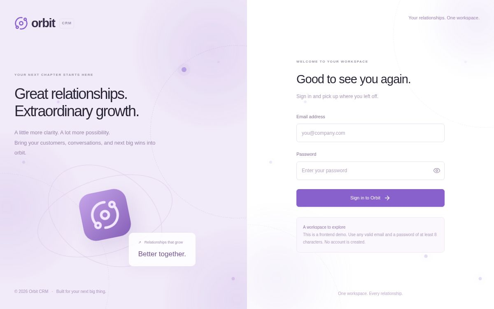

# Orbit CRM

Frontend-only CRM built with Next.js App Router, TypeScript, Tailwind CSS 4 and Lucide icons.

## Run locally

```sh
npm install
npm run dev
```

Open http://localhost:3000. `npm run build` creates a static export in `out/`.

## Routes

- `/`: responsive login form
- `/login/`: validated demo sign-in
- `/dashboard/`: overview and charts
- `/customers/`: searchable, sortable customer table
- `/customers/[id]/`: statically generated customer details
- `/deals/`: draggable sales pipeline
- `/tasks/`: task list and filters
- `/settings/`: profile and preferences
- `/reports/`: additional charts
- `/calendar/`: task and deal calendar

Use any valid email and a password of eight or more characters. This simulated sign-in does not provide real authentication or server-side security. No passwords are stored or transmitted by the app.

## Features

Responsive navigation, summary cards, monthly revenue chart toggle, additional pipeline and closing charts, recent activities, persistent local tasks, create-deal and task dialogs, CSV export, notification panel, and browser-data reset. The command palette and global search open from the header or with Ctrl/⌘ K. An onboarding tour opens on first use and can be replayed from the sidebar.

Mock seed data lives in `lib/data.ts`. New deals and tasks persist in localStorage. Summary revenue, historical trends, customer totals and pipeline distribution are illustrative fixtures, not live aggregates. The dashboard redirects to login when no demo session exists. Signing out clears the session.

## Customers and pipeline

The Customers section includes 12 mock records, combined search/status/industry filtering, name/company/status sorting, pagination, and detail views with company data, activity history, associated deals, and editable browser-persisted notes. The Deals section provides Lead, Contacted, Proposal, Negotiation, Won and Lost columns. Cards show customer, value and closing date; drag and drop or a stage selector moves a deal and persists the change. Value and closing-date filters narrow the board. Tasks can be filtered by status, priority, due date and search. Customer links open the corresponding details. Existing local deals are retained, and legacy Qualified deals migrate to Contacted. Customer and active-deal counts and pipeline values reflect the current data; historical revenue remains illustrative.

## Calendar and preferences

The calendar shows task due dates and deal closing dates with a selected-day agenda. Settings persist the profile, notification preferences, light/dark/system theme, four accent colors and English/Arabic interface preference in the browser. Arabic uses right-to-left layout and translated primary navigation and feature labels; mock record content remains in English. All data stays in this browser. This is a frontend demonstration with no backend.

## Live demo

[Open Orbit CRM on Vercel](https://orbit-crm-two-omega.vercel.app/)

## Screenshot



## Component architecture

- `app/` contains independent App Router pages and the static customer detail route.
- `components/dashboard-shell.tsx` checks the simulated browser session before mounting the workspace.
- `components/workspace.tsx` coordinates page state and shared chrome; feature views live in dedicated components such as `customer-views.tsx`, `deals-board.tsx`, `tasks-view.tsx`, `settings-view.tsx`, and `bonus-features.tsx`.
- `components/ui/index.tsx` exports reusable buttons, inputs, cards, tables, badges, modal, dropdown, search bar, pagination, empty state and loading skeleton.
- `lib/` holds typed mock customers, deals, tasks and preferences.
- `app/globals.css` defines the visual system and motion; Tailwind utility classes are also used in shared components. Motion respects `prefers-reduced-motion`.

## Deployment

The project is a static Next.js export: `npm run build` writes `out/`. Import the repository into Vercel as a Next.js project and deploy with the default build command. If Vercel asks for an output directory, use `out`. Client-side routes are prerendered at build time. There is no backend or production authentication; any valid email and eight-character password opens the demo.

## Verification

Run `npm run typecheck` and `npm run build`. The build generates all core routes, the bonus routes, and twelve customer detail pages. Check desktop, tablet and phone widths in a browser.
